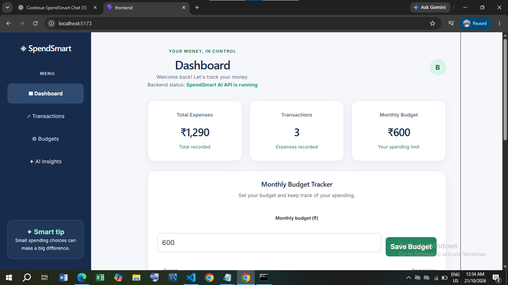

# SpendSmart AI 💰

SpendSmart AI is a personal expense management web application designed to help users track expenses, manage budgets, and understand their spending habits through a simple dashboard.

## 📸 Dashboard



## 🚀 Features

- Add and manage daily expenses
- Categorize expenses
- Track total spending
- Set monthly budgets
- View spending summaries
- Monitor budget usage
- User-friendly dashboard
- AI-powered spending insights

## 🛠️ Tech Stack

### Frontend
- React.js
- JavaScript
- HTML
- CSS
- Vite

### Backend
- Python
- Flask

### Database
- SQLite

### Tools
- Git
- GitHub
- VS Code

## 📁 Project Structure

```text
SpendSmart-AI/
├── backend/
│   └── app.py
├── frontend/
│   ├── src/
│   ├── public/
│   └── package.json
├── package.json
├── package-lock.json
└── .gitignore